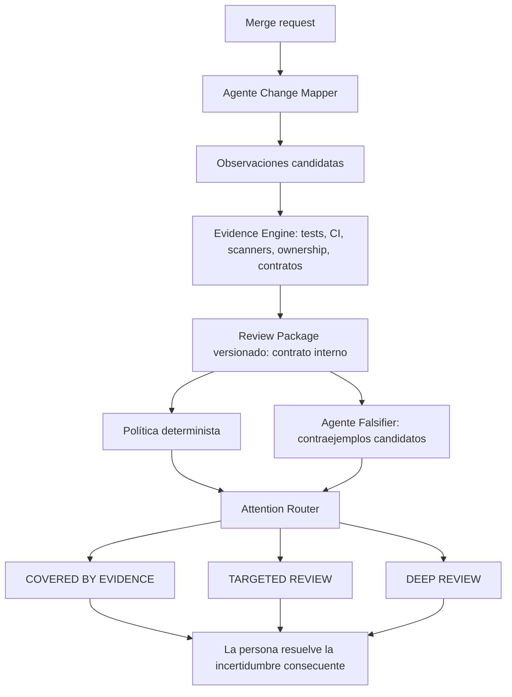
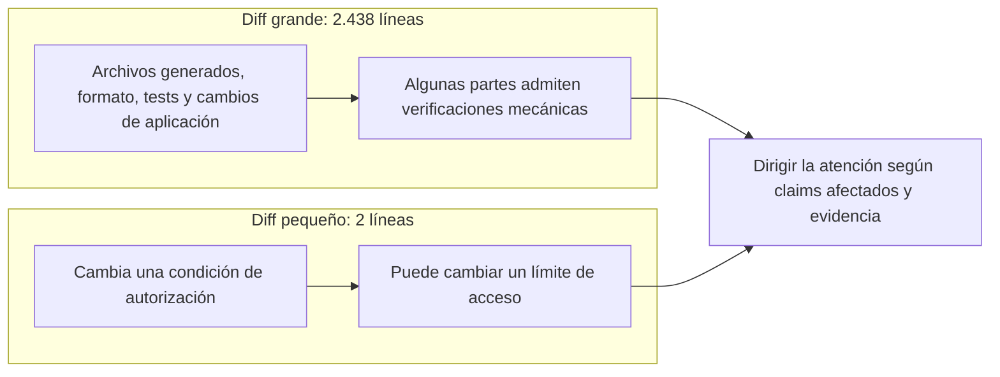
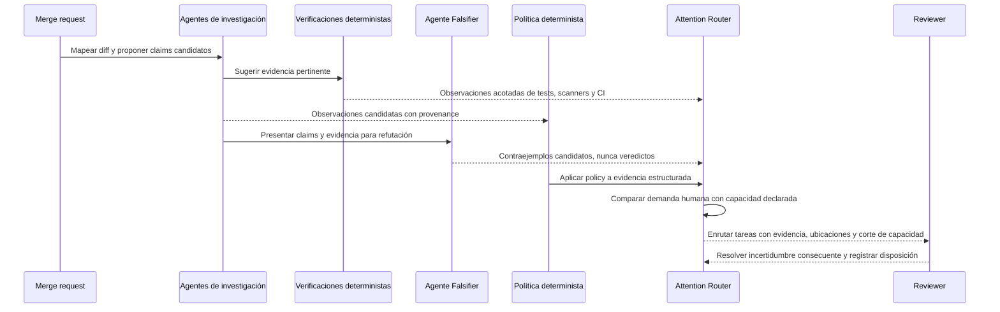
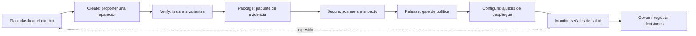
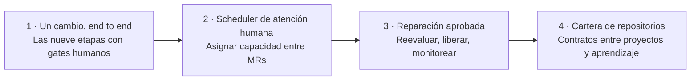

# TO BUILD A FIRE

[English](README.md) · [Español](README.es.md) · [README técnico](TECHNICAL_README.md) · [Demo en vivo](https://tbaf-review-explorer-zxmd2hmaaa-uc.a.run.app/)


Cuando las personas y los agentes de programación pueden abrir más merge requests de las que un equipo alcanza a inspeccionar con cuidado, sumar otra corriente de comentarios automáticos puede agrandar la cola. TO BUILD A FIRE es una idea de producto para dirigir el esfuerzo de revisión: reunir evidencia sobre un cambio, identificar qué sigue sin resolverse e indicar dónde hace falta el juicio humano.


## El problema

La cantidad de cambios propuestos puede crecer más rápido que la capacidad humana para revisarlos. El tamaño del diff es una guía pobre: un lockfile generado puede ocupar cientos de líneas, mientras que un cambio de dos líneas en autorización puede alterar quién accede a datos sensibles.

Enviar cada cambio a otro revisor de IA puede dejar al reviewer con el diff original y más comentarios, resúmenes y hallazgos para evaluar. Los equipos necesitan ver qué cambió, qué propiedades importantes pudieron verse afectadas, qué evidencia existe y qué requiere todavía a una persona.

## Qué hace

TO BUILD A FIRE es un **enrutador de atención para merge requests**. Asigna la capacidad humana finita a los cambios donde sigue habiendo incertidumbre consecuente, y muestra motivos, ubicaciones, minutos demandados y trabajo que queda fuera de la capacidad. Un `Review Package` versionado es el contrato interno que transporta evidencia entre componentes; no es el producto. El sistema no toma la confianza de un agente ni un puntaje único de riesgo como prueba.

**Los agentes producen observaciones. La verificación produce evidencia acotada. La policy enruta atención. Las personas resuelven lo que sigue siendo consecuente e incierto.**



El router tiene tres rutas de atención explicables:

| Ruta | Significado |
| --- | --- |
| `COVERED_BY_EVIDENCE` | Los claims declarados tienen la evidencia requerida por la política indicada. No significa “seguro” ni autoriza un merge. |
| `TARGETED_REVIEW` | Hay claims consecuentes cuya incertidumbre persiste; el router señala claims, brechas de evidencia y ubicaciones concretas. |
| `DEEP_REVIEW` | El impacto es amplio, contradictorio o demasiado incierto para una revisión acotada; una persona debe evaluar el cambio en profundidad. |

Estados como `SUPPORTED`, `UNRESOLVED`, `CONTRADICTED` y `NOT_RUN` describen qué establecieron las verificaciones. Son distintos de las rutas de atención. Los gates explícitos de merge o release son una decisión de política aparte. El motor local exige alcance declarado y verificaciones para el SHA exacto. GitLab CI ya produce evidencia de MRs reales y ejecuta una verificación acotada de invariantes de autorización; sigue siendo una ayuda para dirigir la revisión, no un gate de merge o despliegue.

## Una distinción útil

Comparemos dos cambios:



La cantidad de líneas ayuda a describir el diff, pero no determina cuánto hay que revisarlo. El sistema debería informar por separado la **superficie cubierta por evidencia** y la **superficie pendiente de revisión**. No debe llamar seguro a un fragmento que no necesita revisión humana sólo porque fue resumido o clasificado como mecánico.

El repositorio lo muestra con su propio archivo generado. `evaluation/generated/route-matrix.json` es una tabla de decisiones del router de unas 10.000 líneas, generada a partir de un spec corto. Un check específico la regenera con el código de la rama por defecto y compara byte a byte. Un diff grande que se reproduce exactamente puede quedar cubierto por evidencia; una sola línea editada a mano hace fallar el check y va a revisión. El check prueba que el archivo es reproducible, no que el cambio del spec sea acertado. Ver [`docs/generated-artifacts.md`](docs/generated-artifacts.md).

## Qué diferencia a este enfoque

| Cola de revisión típica | TO BUILD A FIRE (propuesto) |
| --- | --- |
| Ordenar por tamaño, etiquetas o un puntaje único | Explicar la atención necesaria con claims afectados, política y evidencia |
| Acumular comentarios automáticos para que una persona los lea | Reunir evidencia primero y señalar lo que sigue sin resolverse |
| Tomar un scanner limpio o un pipeline verde como señal general | Decir qué verificaciones pasaron y qué claims respaldan |
| Preguntarle a un agente si el cambio parece seguro | Usar agentes para investigar; usar política y evidencia explícitas para decidir el enrutamiento |

## Comportamiento esperado

El Attention Router debería indicar cuánta revisión humana se necesita, cuánta capacidad hay, qué queda fuera de esa capacidad y por qué. Cada tarea enlaza a los claims afectados, ubicaciones, evidencia y sus límites, política y origen del cálculo de tiempo. Si la estimación no tiene respaldo, la demanda es `UNKNOWN`, nunca cero. Los claims candidatos de los agentes siguen siendo candidatos hasta ser corroborados o adjudicados.

Por ejemplo, un equipo con 180 minutos de revisión y una demanda estimada de 267 vería 180 minutos asignados y 87 todavía sin cubrir. “Asignado” describe el uso de capacidad; no significa que el código esté cubierto por evidencia ni que sea seguro. Las cifras ilustran la vista deseada y no son resultados medidos del proyecto.

```text
Capacidad de revisión hoy: 180 min
Demanda estimada:          267 min
Asignado:                  180 min
Todavía sin cubrir:         87 min

Dentro de capacidad              Aún necesita atención
MR !82   auth       35 min        MR !109  auth       42 min
MR !91   payments   50 min        MR !114  payments   45 min
MR !77   infra      40 min
MR !103  API        25 min
MR !66   deps       30 min
                         ───                            ───
                         180                             87 min
```



## Dirección para el hackathon

TO BUILD A FIRE fue creado específicamente para GitLab Transcend: Life After Code y participa en **Track A — Start Fresh**, con autonomía Assisted. El proyecto Showcase de GitLab es el entorno de integración del hackathon; GitHub se mantiene sincronizado como espejo público.

La evaluación prevista usa cambios sembrados y controles benignos: diffs generados, actualizaciones de dependencias, refactors sólo de formato, tests faltantes, ampliación de autorización en dos líneas, scanners eliminados, assertions debilitadas, umbral de coverage reducido, comandos de CI que terminan en `|| true` y evaluaciones Duo con SHA obsoleto frente al exacto. El inventario está en [`evaluation/corpus.json`](evaluation/corpus.json). Dos jobs de GitLab CI comprueban fixtures del contrato del router determinístico con [`evaluation/run_cases.py`](evaluation/run_cases.py) y del enlace de evaluaciones con [`evaluation/run_link_cases.py`](evaluation/run_link_cases.py). No miden la calidad de detección ni verifican la verdad de la completitud declarada por el mapper. [`test_gitlab_assessment_link.py`](tests/test_gitlab_assessment_link.py) también comprueba que se rechace una evaluación obsoleta y que una del SHA exacto se enlace sin cambiar el paquete determinístico. La evaluación completa busca medir casos críticos enviados a personas, escalaciones benignas innecesarias, minutos humanos frente a una línea base declarada y conclusiones no respaldadas. Todavía no hay métricas del producto.

La demo prevista contrasta un cambio grande, mayormente generado, con un cambio mínimo de autorización y luego muestra la demanda de atención frente a la capacidad del equipo. Debería mostrar cómo la evidencia y los claims protegidos afectan el enrutamiento, sin afirmar que el sistema ya redujo el tiempo de revisión.

El concepto se conecta con el ciclo post-código del hackathon GitLab Transcend:



El objetivo es que un mismo recorrido de MR atraviese las nueve etapas con evidencia observable. La [matriz Track A / Assisted](docs/hackathon-track-a.md#nine-stage-coverage-contract) define qué prueba necesita cada etapa; todavía no afirma que las integraciones estén ejecutándose.

## Explorador de Review Packages

La interfaz del navegador muestra la ruta de atención, claims sin resolver, verificaciones, tareas humanas y observaciones candidatas de un Review Package. También acepta un sobre enlazado v2 y muestra las notas candidatas de Duo y su completitud declarada junto a la ruta determinística. Esa completitud sigue sin verificarse y no puede cambiar la ruta. Elegí un artefacto de CI desde tu dispositivo: JavaScript lo lee localmente y nunca lo sube. El ejemplo incluido es el snapshot del MR !2, reconstruido desde datos públicos de GitLab con el mismo código del snapshot de CI (ver [`docs/reproduced-evidence-2026-10-23.md`](docs/reproduced-evidence-2026-10-23.md)); la interfaz muestra el digest SHA-256, pero no lo verifica. Podés elegir español o inglés y tema claro u oscuro; la interfaz recuerda tus preferencias en el dispositivo. El texto de evidencia escrito por agentes conserva su idioma original.

Para ejecutarla desde la raíz del repositorio:

```sh
python3 -m http.server 18765 --directory web
```

Abrí `http://localhost:18765`. El mismo visor también está en vivo en **https://tbaf-review-explorer-zxmd2hmaaa-uc.a.run.app/**, servido desde un contenedor NGINX sin privilegios en Cloud Run a través de un job manual de GitLab con OIDC, limitado a `main` protegida y variables protegidas; IAM/WIF de Google ya está configurado para ese job. Su endpoint `/health` responde correctamente, y el monitoreo en ejecución todavía no existe. Ver [`deployment/cloud-run/README.md`](deployment/cloud-run/README.md) para despliegue y monitoreo.

## Mapa del repositorio

- `README.md` — descripción del proyecto y comportamiento esperado.
- `README.es.md` — versión en español de la descripción.
- `TECHNICAL_README.md` — arquitectura propuesta, límites de decisión, modelo de evidencia y preguntas abiertas.
- `TODO.md` — destino completo, niveles de construcción, invariantes y criterios de cierre.
- `docs/hackathon-track-a.md` — contrato Track A / Assisted, evidencia por etapa, permisos requeridos y entregables del hackathon.
- `.gitlab/duo/flows/attention-review.yml` — configuración versionada del flow de mapeo de MR. El flow activo del proyecto es otro objeto en GitLab; hay que mantenerlo sincronizado antes de depender de su evaluación JSON estructurada.
- `.gitlab-ci.yml` — SAST de GitLab en pipelines de MR, contrato, router de ejemplo, captura de MR en `main` y enlace condicional de evaluaciones Duo. Los hallazgos SAST del SHA exacto se incluyen como evidencia orientativa en Review Package v3; si el informe no está disponible, queda indicado y no cambia la ruta. Ver [`docs/sast-review-package.md`](docs/sast-review-package.md).
- `web/` — interfaz local-first para explorar Review Packages y el snapshot registrado del MR !2.
- `Dockerfile`, `deployment/cloud-run/`, `.gcloudignore` — contenedor estático y configuración de despliegue en Cloud Run, desplegado en vivo en [tbaf-review-explorer-zxmd2hmaaa-uc.a.run.app](https://tbaf-review-explorer-zxmd2hmaaa-uc.a.run.app/) con el health check en verde; la protección del entorno de GitLab sigue siendo una restricción opcional por ajustar.
- `scripts/setup-cloud-run-gcp.sh` — preparación desde terminal de IAM/WIF y variables protegidas de CI en GitLab.
- `scripts/reproduce_public_mr_snapshot.py` — reconstruye fuera de CI el Review Package de un MR a partir de datos públicos de GitLab.
- `docs/evidence/` — artefactos registrados que sobreviven a la retención de artefactos de CI.
- `docs/adr/` — decisiones de arquitectura y sus supuestos.
- `.gitignore` — entornos locales de Python, cachés, artefactos de build y secretos.
- `visual/` — banner del proyecto y futuros recursos gráficos.
- `docs/red-team/` — revisiones adversariales de diseño y su evidencia.
- `LICENSE` — licencia MIT, copyright © 2026 Anna Tchijova.

## Próximos pasos

El producto se plantea como niveles completos y conectados. Cada nivel sirve por sí mismo y conserva los límites de evidencia, política y autoridad que necesita el sistema final. Los niveles describen el destino y un camino de construcción; no afirman que este repositorio ya los implemente.



| Nivel | Estado completo y útil |
| --- | --- |
| **1. Un cambio, end to end** | Recorrer las nueve etapas post-code con un MR real de GitLab, GitLab Duo, evidencia acotada, checkpoints humanos, release protegido, despliegue en Cloud Run y monitoreo. |
| **2. Scheduler de atención humana del equipo** | Asignar el presupuesto de revisión entre MRs, mostrar el corte de capacidad y el trabajo consecuente que sigue sin revisar. |
| **3. Reparación aprobada y reevaluación** | Una reparación acotada crea una revisión separada con evidencia nueva, gates de release/deploy y monitoreo enlazados a la decisión original. |
| **4. Cartera de repositorios** | Los equipos pueden aplicar políticas compatibles a repositorios relacionados, contemplar contratos y dependencias entre proyectos, y comparar esfuerzo y resultados medidos de revisión. Cualquier ajuste sigue siendo explicable y no puede debilitar en silencio la evidencia o política requerida. |

El destino completo es un sistema de atención que contempla una cartera de repositorios, sigue el cambio desde su propuesta hasta la evidencia posterior al despliegue, dirige el juicio humano a claims consecuentes aún sin resolver y registra por qué cada acción fue permitida, enrutada o detenida. El plazo del hackathon modifica cuántos niveles se intentan; no cambia el criterio de finalización ni vuelve descartable un nivel incompleto. El [README técnico](TECHNICAL_README.md#destination-and-build-levels) detalla los límites de cada nivel, la evidencia de finalización y los invariantes que se heredan desde el primero.

El lenguaje de implementación elegido es Python. El proyecto usa la licencia MIT; ver [LICENSE](LICENSE).

### Motor local de atención

La CLI acepta un registro JSON no confiable y acotado `tbaf.review-input/v1` y un archivo separado `tbaf.policy/v1`, y emite un recibo interno determinista, identificado por SHA-256. Los archivos modificados fuera del alcance de claims declarados y los candidatos obsoletos se enrutan a revisión profunda. Las observaciones candidatas no pueden despejar claims incluidos por policy; las verificaciones requeridas deben estar reportadas como exitosas para el SHA exacto del head. El esfuerzo desconocido permanece desconocido. La policy debe venir de una ubicación confiable y protegida; la CLI todavía no autentica quién produjo cada verificación ni su artefacto, así que el recibo sólo evalúa los registros recibidos.

```bash
python -m pip install -e .
tbaf-route examples/review-input.json --policy examples/policy.json
```

Este contrato local inicial cubre un MR; no es un gate de merge, un veredicto de seguridad ni una medición de reducción del tiempo de revisión. El job de GitLab para capturar un MR en modo de sólo lectura ya se ejecutó en vivo; ver el [registro del resultado](docs/live-evidence-2026-10-09.md).
El [plan de construcción](TODO.md) detalla los niveles y sus criterios de cierre.

## Estado del proyecto

GitLab CI generó una captura de MR real, de sólo lectura, y ejecutó una verificación acotada de invariantes de autorización contra un control sembrado. Para el MR !2, sobre el head `e843e0d`, la verificación informó `FAIL`; el Review Package mantuvo el claim como `UNRESOLVED` y lo dirigió a `TARGETED_REVIEW`. La pipeline pasó porque produjo el recibo; eso no significa que el claim de autorización haya pasado.

Después de aprobación humana, el flow Duo generó una evaluación candidata `tbaf.duo-assessment/v2`. El linker de `main` devolvió `status: linked` para la nota interna `3992319519`, sobre el SHA exacto del paquete y con `diff_coverage_status: complete`, en la pipeline [#2935454761](https://gitlab.com/gitlab-ai-hackathon/transcend-october-2026/1688368/showcase/-/pipelines/2935454761). Es una asociación exacta observada en vivo, no una tasa de error medida; la API de notas no certifica la identidad del flow ni autentica por separado el origen declarado por el agente.

GitLab SAST corrió en la pipeline de MR [#2934776373](https://gitlab.com/gitlab-ai-hackathon/transcend-october-2026/1688368/showcase/-/pipelines/2934776373) y produjo una observación candidata `bandit.B101` informativa. Review Package v3 ahora incluye datos acotados de informes SAST exitosos asociados al SHA exacto del MR. Los hallazgos siguen siendo orientativos y no alteran la ruta; ver [`docs/sast-review-package.md`](docs/sast-review-package.md).

IAM/WIF de Google ya está configurado para el job de despliegue en Cloud Run. Los artefactos de snapshot y enlace de esas pipelines vencieron a la semana; el paquete del MR !2 se reconstruyó desde datos públicos con el mismo código del snapshot y quedó en [`docs/evidence/`](docs/evidence/). Coincide con la ruta, el resultado del check y el estado del claim registrados, pero no es un artefacto de CI y no incluye observaciones de Duo. Ahora esos jobs conservan los artefactos durante un año.

La primera revisión de Cloud Run, `tbaf-review-explorer-00001-6cs`, se desplegó desde `5ac8c93` en la pipeline [#2979674219](https://gitlab.com/gitlab-ai-hackathon/transcend-october-2026/1688368/showcase/-/pipelines/2979674219). Su health check devolvió HTTP 404 porque Cloud Run reserva `/healthz`. El MR !29 movió el endpoint a `/health`; la revisión `tbaf-review-explorer-00003-7hq` redesplegó con esa corrección, y `/health` ahora devuelve `200 ok` en la URL en vivo de arriba. GitLab sigue devolviendo HTTP 403 al proteger el entorno `cloud-run-demo` con el rol actual, y el monitoreo en ejecución más allá del health check todavía no existe. El [guion de demo](docs/demo-script.md) es anterior a este despliegue y todavía señala Cloud Run como pendiente; actualizarlo antes de grabar.

Ver [`docs/hackathon-track-a.md`](docs/hackathon-track-a.md), la [evidencia del snapshot](docs/live-evidence-2026-10-09.md), la [evidencia del enlace v1](docs/live-e2e-assessment-link-2026-10-10.md), la [evidencia del enlace v2](docs/live-e2e-assessment-link-2026-10-11.md) la [evidencia SAST](docs/live-sast-2026-10-10.md) y la [evidencia reproducida y de despliegue](docs/reproduced-evidence-2026-10-23.md).
